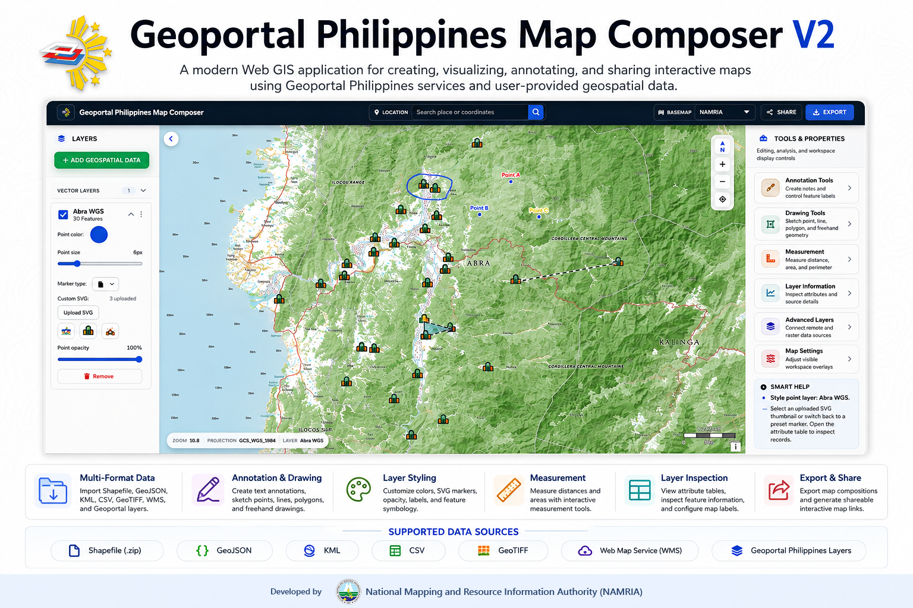

<p align="center">
  
</p>

# Geoportal Philippines: Map Composer V2 (GPMapCompV2)

A modern web-based Geographic Information System (GIS) application developed as part of the **Geoportal Philippines initiative** to help users create professional, publication-ready map compositions directly from a web browser.

GPMapCompV2 combines local geospatial datasets, online map services, feature styling, annotations, drawing tools, measurements, and export capabilities into a single interactive workspace. The application is designed to provide a lightweight, browser-based alternative for common mapping workflows without requiring traditional desktop GIS software.

> **Project Status:** Active Development

---

## Live Demo

🌐 **GitHub Pages**

https://bcballesteros.github.io/GPMapCompV2/

---

## About the Project

Geoportal Philippines: Map Composer V2 is the next-generation implementation of the Map Composer application under the Geoportal Philippines initiative.

The project aims to provide an intuitive and efficient web-based environment for visualizing, styling, annotating, and exporting geospatial data. It supports both locally uploaded datasets and online mapping services, enabling users to create customized map compositions suitable for presentations, reports, and general GIS workflows.

The application is built using modern web technologies with an emphasis on maintainability, modular architecture, usability, and long-term scalability.

---

## Key Features

### Geospatial Data

The Layers panel presents uploaded vectors, WMS and Geoportal overlays in one
**Map Layers** list, ordered **Top → Bottom** by their effective map stacking
order. Each card includes a compact source label and feature count or service
description. Visibility, styling, Rename, Zoom to Layer, two-line names and
full-name tooltips remain available. Basemaps and operational tools stay separate.
This display does not change map stacking or provide interactive reordering.
See [Layers panel implementation and acceptance checks](LAYERS_PANEL.md).

- Upload multiple geospatial datasets
- Shapefile ZIP (.zip)
- GeoJSON
- GeoPackage (.gpkg), vector feature tables with table selection
- KML
- CSV
- GeoTIFF (limited support)
- Web Map Service (WMS)
- Geoportal Layer integration

GeoPackage import supports Point/MultiPoint, LineString/MultiLineString and
Polygon/MultiPolygon, including holes. Select **GeoPackage (.gpkg)** in **Add
Geospatial Data**, choose a file, select feature tables, and click the existing
**Upload** button. Each table becomes a separate managed layer with the existing
styling, labels, attribute table, SLD, legends, Export and Share controls.

Imports are vector-only: tile/raster data is ignored. Source coordinates are
transformed to WGS84 before map conversion. EPSG:4326, EPSG:3857, WGS84 UTM and
supported file CRS definitions with reliable datum parameters are accepted;
unknown/unreliable CRS is rejected with reprojection guidance. Explicit supported
GeoJSON CRS declarations are also transformed correctly.

Limits per import: **50 MiB file, 50,000 selected features, 1,000,000 coordinate
positions, 32 MiB estimated attribute data, 1 MiB per attribute value**. Modern
browsers with module workers and WebAssembly are required. GeoPackage code and
SQLite assets load locally on demand. Large integers are preserved as decimal
strings, binary values as `hex:` strings, and date-like values as their source
text. See [GeoPackage implementation and QA guide](GEOPACKAGE_IMPORT.md) for
policies, tested behavior, runtime requirements and limitations.

### Layer Management

- Multiple layer support
- Layer visibility
- Layer transparency
- Feature labeling
- Attribute table
- Zoom to layer
- Custom feature symbology
- SVG and custom image markers

### Annotation & Drawing

- Text annotations
- Annotation management
- Drawing tools
- Distance measurement
- Area measurement
- North arrow
- Scale bar

### Export & Sharing

- Export to PNG
- Export to JPEG
- Export to PDF
- Email-based sharing of static PNG, JPEG, and PDF map outputs

The Export and Share small previews open the same centered inspection viewer.
Its desktop window uses about 86% of viewport width and 84% of viewport height,
with safe margins on narrow screens. Fit to Window uses the measured image area
and refits after resizing; manual zoom keeps its source scale and clamps panning
to the new bounds. The 100% control maps one output canvas pixel to one CSS pixel.
The viewer reuses the full-resolution output canvas, so detail is limited by the
generated output resolution. Its zoom and resize controls do not change the map
composition or exported files.

---

## Technology Stack

GPMapCompV2 is built using modern web technologies for performance, maintainability, and scalability.

| Technology | Purpose |
|------------|---------|
| OpenLayers | Interactive web mapping |
| JavaScript (ES Modules) | Application logic |
| HTML5 | Application structure |
| CSS3 | User interface styling |
| Vite | Development server and production build |
| shpjs | Shapefile parsing |

---

## Supported Data Formats

### Vector Data

- Shapefile (.shp)
- GeoJSON (.geojson)
- Keyhole Markup Language (KML)
- Comma-Separated Values (CSV)

### Raster Data

- GeoTIFF (.tif / .tiff) *(limited support)*

### Online Services

- Web Map Service (WMS)
- Geoportal Layers

---

## Getting Started

### Prerequisites

Before running the project locally, ensure you have the following installed:

- Node.js
- npm

---

### Installation

Clone the repository.

```bash
git clone https://github.com/bcballesteros/GPMapCompV2.git
```

Navigate to the project folder.

```bash
cd GPMapCompV2
```

Install project dependencies.

```bash
npm install
```

---

### Run the Development Server

```bash
npm run dev
```

The application will be available at:

```
http://localhost:5173
```

---

### Build for Production

```bash
npm run build
```

---

### Preview the Production Build

```bash
npm run preview
```

---

## Project Structure

The project is organized into modular components to improve maintainability and support future enhancements.

```text
GPMapCompV2/
├── public/              # Static assets
├── src/                 # Application source code
│   ├── components/      # Reusable UI components
│   ├── controls/        # OpenLayers controls
│   ├── layers/          # Layer management
│   ├── styles/          # Styling and symbology
│   ├── tools/           # Application tools
│   ├── ui/              # User interface modules
│   ├── utils/           # Shared utilities
│   └── ...
├── index.html
├── package.json
├── vite.config.js
└── README.md
```

> The project structure continues to evolve as new features and modules are introduced.

---

## Application Workflow

Export and Share automatically include legends for visible supported uploaded
vector layers. See [Output legends](OUTPUT_LEGENDS.md) for inclusion rules,
layout, resource limits, verification and visual fidelity notes.

A typical workflow in GPMapCompV2 consists of the following steps:

1. Upload one or more geospatial datasets.
2. Configure layer styles and visibility.
3. Apply feature labels and symbology.
4. Add annotations or drawing graphics.
5. Perform map measurements when needed.
6. Export or share the completed map composition.

### Share Map remarks

Use **Custom Message / Remarks (Optional)** below the recipient and format controls
to include multiline text in the email. The field accepts up to 500 characters.
Every recipient receives the same message and an individual map link. Full success
clears the message. Failed and partial deliveries keep it for manual retry with
the remaining recipients.

`POST /api/share` accepts an optional `customMessage` string with either the legacy
`recipientEmail` field or the `recipientEmails` array. Both request formats also
accept requests that omit the message. The API normalizes line endings to LF and
checks JavaScript string length before trimming outer whitespace. A blank message
is omitted from the email. The email treats the message as plain text and escapes
it for HTML. The message is used only in the recipient email and has no database storage.

---

## Roadmap

Future development will continue to focus on improving usability, performance, and mapping capabilities.

Planned areas of enhancement include:

- Additional export customization
- Improved GeoTIFF support
- Enhanced editing capabilities
- Additional map layout elements
- Performance optimizations
- User interface refinements
- Continued codebase modularization

The roadmap will continue to evolve as new requirements and user feedback are incorporated.

---

## Desktop workspace presentation

The Layers sidebar scales from 256 to 288 px (`21.1vw`); Tools & Properties scales from 264 to 300 px (`22vw`). Both remain in the flex layout beside the map, and their existing collapse controls return their space to the map. Interface headings, tool descriptions, buttons, and form text use a slightly larger hierarchy while map and exported cartographic text retain their own sizing.

The sidebars use the Phase 1A surface and apply a 3 px backdrop blur in supported browsers. The map stays between the inline panels. The desktop browser test verifies sidebar widths, collapse preferences, and OpenLayers sizing at 1920 × 1080, 1440 × 900, 1366 × 768, 1280 × 800, and 1100 × 700.

## Phone and tablet workspace

At widths of 1024 CSS px or less, or heights of 480 CSS px or less, the map fills the workspace and the navbar exposes **Layers** and **Tools**. The navbar uses two rows at widths of 720 px or less and gives the controls more room on very narrow phones at 340 px or less. Location search, basemap selection, Share, and Export stay in the navbar. Short viewports use a horizontal map-control cluster with zoom, reset, and the north indicator. The scale, attribution, and compact status bar sit along the bottom.

The existing sidebars open one at a time as scrollable drawers with pinned close buttons. Close a drawer with its close button, by tapping the backdrop, or by pressing Escape. Focus enters at the close button, cycles within the drawer, and returns to the trigger on dismissal. Hidden drawers and the background are inert while appropriate. A dialog launched from a drawer takes focus above it, and the drawer resumes when the dialog closes. The annotation editor uses its existing map backdrop and opens after the Tools drawer closes.

Drawers start closed and dismiss on rotation or when the layout crosses the workspace breakpoint. Desktop collapse preferences stay in session storage and are reapplied when the inline layout returns. The same OpenLayers map observes its target size, preserving the view, layers, and GIS state. Drawers and dialogs use dynamic viewport height with a fallback, account for safe areas, and use the browser's visual viewport when a keyboard reduces the visible height. Dialog bodies scroll between the header and actions. Export and Share retain their existing preview rendering and output dimensions.

Chrome automation covers 768 × 1024 and 1024 × 768 tablets, 360 × 800, 390 × 844, and 430 × 932 phone portrait sizes, and 800 × 360, 844 × 390, and 915 × 412 phone landscape sizes. Enable the mobile and desktop browser tests with `TEST_MOBILE_BROWSER=1` and `TEST_DESKTOP_BROWSER=1` respectively. An optional `MOBILE_SCREENSHOT_DIR` captures representative rendered layouts. The mobile test uses synthetic vector data, a mocked geocoder, and Chrome touch emulation.

Touch layer reordering remains unsupported. Desktop pointer drag-and-drop remains available. For physical-device acceptance, verify Chrome on Android and Safari on iPhone or iPad in both orientations. Exercise map pans and pinches, drawer scrolling and dismissal with a screen reader, file selection, address-bar and keyboard changes, annotation editing, measurement completion, and Export and Share preview controls with a real map composition.

---

## Acknowledgements

GPMapCompV2 is being developed as part of the **Geoportal Philippines initiative**.

The project is intended to provide a modern, browser-based GIS application that supports map composition, visualization, annotation, and export while integrating both local geospatial datasets and online mapping services.

Development continues through iterative refinement with an emphasis on maintainability, usability, and practical GIS workflows.

---

## Contact

For questions, suggestions, or feature requests, please use the GitHub Issues section of this repository.

---

<div align="center">

**Geoportal Philippines: Map Composer V2 (GPMapCompV2)**

*A modern browser-based GIS application for creating professional map compositions.*

</div>
